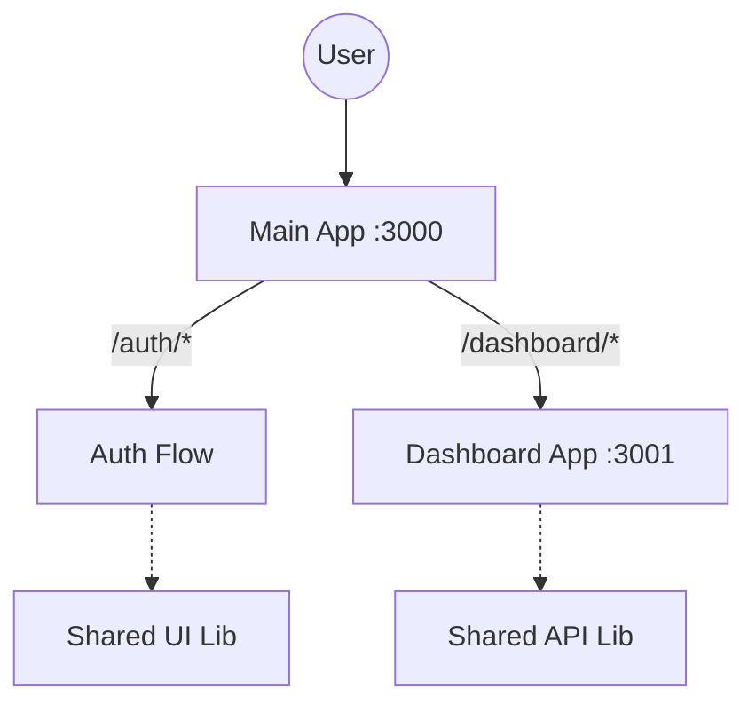

# ADR-001: Choosing Next.js Multi-Zones to scale the monorepo

**Status:** Accepted  
**Date:** 2026-04-25  
**Author:** Antigravity/rbikbov

## 1. Context

The project is a monorepo with several independent apps (`main`, `dashboard`). They need to be served under a single domain while keeping teams, build cycles and deployments independent.

**Constraints:**

- The shared libraries (`libs/shared`) must remain usable.
- Local development should stay simple (no local proxy servers such as Nginx).
- The auth flow (BFF) must work across the apps.

## 2. Decision

Use the **Next.js Multi-Zones** architecture, with routing configured through `rewrites` in the main app (`main`). All apps remain independent zones, but to the browser they look like a single project.

## 3. Technical details and mechanisms

- **Routing**: the main app (`apps/main`) acts as a "proxy" and forwards `domain.com/dashboard/:path*` (or `dashboard.domain.com`) requests to the second zone via `next.config.js`.
- **Code sharing**: `transpilePackages` lets `libs/shared` be imported transparently without a separate build step.
- **Styling**: a single Tailwind CSS v4 configuration in `shared/ui` scans the content of all zones to avoid duplicate styles and keep the visuals consistent.

## 4. Alternatives considered

### 4.1. Proxying through Nginx

- **Pros:** technology independence (a Vue app could be added).
- **Cons:** complex local setup, no integration with `next.config.js` and `rewrites`.
- **Decision:** rejected (too complex for a single-framework monorepo).

### 4.2. Monolith (all pages in one app)

- **Pros:** SPA navigation, simple structure.
- **Cons:** bloated bundle, parts of the system cannot be deployed independently.
- **Decision:** rejected (conflicts with the scalability goals).

### 4.3. Micro-frontends

- **Pros:** technology independence (a Vue app could be added).
- **Cons:** complex setup and integration between the apps.
- **Decision:** rejected (too complex for a single-framework monorepo).

## 5. Consequences and risks

### Positive (Pros)

- A single routing config (`next.config.js`) as the source of truth.
- Simple deployment to Vercel/Netlify.
- Bundle isolation: a failure in one zone does not break the frontend of another.

### Negative / Risks (Cons/Risks)

- **Hard navigations**: moving between zones requires a full page reload (`<a>` instead of `<Link>`).
- **Mitigation**: shared styles and asset caching keep the transition visually as fast as possible.

## 6. Revision history

- **2026-04-25**: Initial architecture description (Antigravity)
- **2026-04-25**: Status changed to Accepted after discussing the advantages over Nginx.
- **2026-04-28**: Added section 4.3 Micro-frontends and clarifications.
