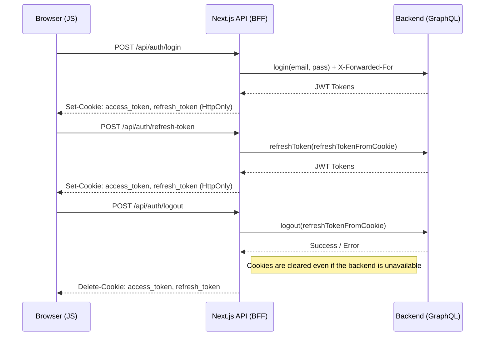

# ADR-002: Secure authentication strategy (BFF + HttpOnly Cookies)

**Status:** Accepted  
**Date:** 2026-04-25  
**Author:** Antigravity/rbikbov

## 1. Context

We need an authentication system that is protected against common attacks (XSS, session hijacking) and still lets rate limiting on the backend work correctly.

**Constraints:**

- JWTs must not be stored in `localStorage` or `sessionStorage` (risk of theft via XSS).
- The backend cannot set secure cookies on its own (proxying is required).
- The real client IP has to be forwarded through the proxy.

## 2. Decision

Implement the **BFF (Backend-for-Frontend)** pattern with Next.js Route Handlers. Tokens are stored only in `HttpOnly`, `Secure`, `SameSite: Strict` cookies. Browser JavaScript has no access to the tokens.

## 3. Technical details and mechanisms

- **Proxy routes**: `/api/auth/login`, `/api/auth/logout`, `/api/auth/refresh`.
- **IP forwarding**: every request from the BFF to the GraphQL backend includes an `X-Forwarded-For` header with the original client IP.
- **Refresh logic**: encapsulated in `GraphQLAuthApi` using Inversion of Control. On a 401 error, the client automatically pauses requests and calls the `onRefreshSession` callback injected by the frontend, which safely calls the BFF.
- **Atomic logout**: logout is fully handled by the BFF, which guarantees that the session on the backend and the local cookies are removed together (no race conditions).

## 4. Alternatives considered

### 4.1. Storing tokens in LocalStorage

- **Pros:** simple to implement, no server-side proxy.
- **Cons:** critically vulnerable to XSS. Any malicious script can steal the user's session.
- **Decision:** rejected as insecure.

### 4.2. Talking to the backend directly via CORS

- **Pros:** no proxying latency.
- **Cons:** the backend has to handle cookies itself.
- **Decision:** rejected in favor of the architectural flexibility of the BFF.

## 5. Consequences and risks

### Positive (Pros)

- High level of security (tokens are not accessible to JS).
- Convenient for frontend developers (no need to attach tokens to every request manually).
- Full control over the session on the server side (BFF).

### Negative / Risks (Cons/Risks)

- A small overhead from proxying requests through Next.js.
- Additional API routes to maintain.

## 6. Revision history

- **2026-04-25**: Document created (Antigravity)
- **2026-04-25**: Added details about SameSite: Strict and X-Forwarded-For.
- **2026-04-28**: Fixed inaccuracies.
