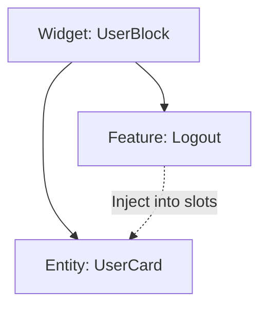

# ADR-003: Architecture methodology (FSD) and dependency inversion (deps)

**Status:** Accepted  
**Date:** 2026-04-25  
**Author:** Antigravity/rbikbov

## 1. Context

As a project grows, classic folder structures (`components/`, `services/`) turn into "spaghetti" where everything depends on everything. We need an extensible structure with clear boundaries of responsibility and no circular dependencies.

**Constraints:**

- Business logic (Features) has to be separated from the visual representation (Entities).
- Lower layers must not know that upper layers exist.
- Code must be easy to test in isolation (e.g. in Storybook).

## 2. Decision

Organize the code with **Feature-Sliced Design (FSD)**. For bottom-up communication between layers (when an entity needs to trigger an action from a feature), use **Dependency Inversion (DI)** through props (`deps`).

## 3. Technical details and mechanisms

- **Layers**: Shared (foundation), Entities (business entities), Features (actions), Widgets (composition), Pages (pages), App (setup).
- **Public API**: each module exports only what is needed through `index.ts`. Deep imports are forbidden.
- **The deps pattern**: Entity-level components accept render functions or event handlers as optional dependencies. The actual logic is "injected" into them by the upper layers.

## 4. Alternatives considered

### 4.1. Flat structure (Components/Hooks)

- **Pros:** quick start on small projects.
- **Cons:** uncontrolled growth of dependencies, hard to refactor.
- **Decision:** rejected because of the long-term risks.

### 4.2. Clean Architecture (with classes and controllers)

- **Pros:** maximum independence from the framework.
- **Cons:** too much boilerplate for a React app.
- **Decision:** rejected in favor of the more frontend-oriented FSD.

## 5. Consequences and risks

### Positive (Pros)

- Highly predictable code: it is always clear where to look for logic ("screaming" architecture).
- Module isolation: changing one feature does not break another.
- Easier onboarding for new developers.

### Negative / Risks (Cons/Risks)

- A steeper learning curve for those unfamiliar with FSD.
- Different people interpret FSD differently, so the team's conventions have to be documented and followed.
- The structure can feel "excessive" in the early stages.

## 6. Revision history

- **2026-04-25**: Document created (Antigravity)
- **2026-04-25**: Added a section about the deps pattern.
- **2026-04-28**: Clarifications.
