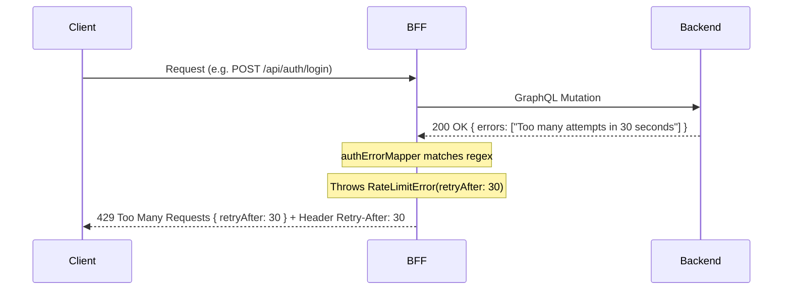

# ADR-004: Unified Error Handling and BFF Translation Strategy

**Status:** Accepted  
**Date:** 2026-05-02  
**Author:** Antigravity

## 1. Context

The project uses GraphQL as the main protocol for talking to the backend. The core problem is that GraphQL, by design, returns `200 OK` even when the `errors` array contains errors. This causes several issues:

- Standard HTTP monitoring and logging tools do not see the errors.
- Browser interceptors and libraries (e.g. TanStack Query) cannot handle errors automatically based on status codes.
- Client code has to parse the `errors` array manually everywhere and try to tell a validation error from a server failure.

**Constraints:**

- The backend may change the wording of errors (e.g. "too many reset attempts" vs "too many login attempts").
- Security standards (rate limiting) must be supported, and the user should be told how long the block lasts.

## 2. Decision

Implement a **unified error mapping and translation system in the BFF layer**.

The BFF acts as a "semantic bridge" that:

1. Executes GraphQL requests against the backend.
2. Analyzes the `errors` array using flexible regular expressions (Error Mapper).
3. Converts protocol-specific errors into domain classes (`ApiError`, `RateLimitError`, etc.).
4. Translates these classes into semantically correct HTTP responses (400, 429, 502) for the frontend.

## 3. Technical details and mechanisms

### Error classification:

- **`ApiError`**: business logic and validation errors (wrong password, email already taken). Translated to **HTTP 400 Bad Request**.
- **`RateLimitError`**: request limit exceeded. Translated to **HTTP 429 Too Many Requests**.
- **`NetworkError` / `ServiceUnavailableError`**: connectivity problems or the backend being down. Translated to **HTTP 502 Bad Gateway**.

### Translation mechanism (BFF):

### Key features:

- **Regex-based mapping**: the mapper supports capture groups (e.g. the number of seconds to wait), so dynamic data can be extracted from the backend's text messages.
- **Retry-After support**: the standard `Retry-After` header is supported for 429 errors.

## 4. Alternatives considered

### 4.1. Handling errors directly on the client

- **Pros:** less logic in the BFF.
- **Cons:** parsing logic duplicated in every feature, standard HTTP statuses cannot be used in the Network tab, error patterns are hard to update in one place.
- **Decision:** rejected.

### 4.2. Using a generic 500 status

- **Pros:** the simplest possible implementation.
- **Cons:** poor UX (specific form fields cannot be highlighted), harder debugging.
- **Decision:** rejected.

## 5. Consequences and risks

### Positive (Pros)

- Clean client code: components work with typed errors and standard statuses.
- Transparent monitoring: Sentry and other tools group errors correctly by HTTP status.
- Flexibility: if the backend changes its error texts, a single regex in the mapper needs updating.

### Negative / Risks (Cons/Risks)

- A more complex BFF: the API route layer carries more logic.
- Risk of a regex "miss": if the backend sends a completely new error text, it may end up as `GENERIC_ERROR`.
- **Mitigation:** unit tests for `auth-error-mapper` that cover all known backend response patterns.

## 6. Revision History

- **2026-05-02**: Initial version of the document (Antigravity).
- **2026-05-02**: Status changed to Accepted.
